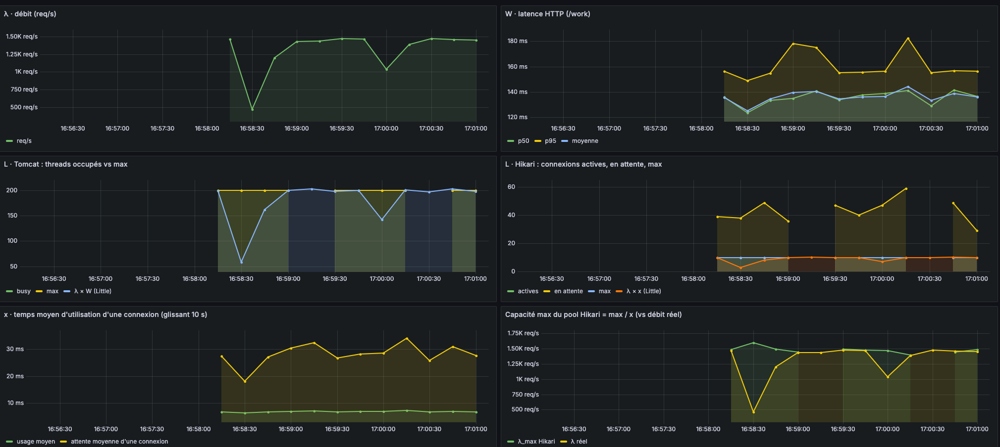

# Little law demo — Spring Boot / Hibernate / HikariCP

Application laboratoire pour rejouer les scénarios de l'article
*Comprendre la saturation d'une application Spring Boot avec la loi de Little*.

## Démarrer

```bash
docker compose up -d          # PostgreSQL sur localhost:5432
./mvnw spring-boot:run        # ou : mvn spring-boot:run
curl 'localhost:8080/work?dbMs=5&appMs=35'
```

L'endpoint `GET /work?dbMs=X&appMs=Y` :

- `dbMs` : `select pg_sleep(X)` dans une transaction → **connexion Hikari + thread Tomcat** occupés (c'est *x*)
- `appMs` : `Thread.sleep(Y)` hors transaction → **seul le thread Tomcat** est occupé

Pools (dans `application.properties`) : `server.tomcat.threads.max=200`, `maximum-pool-size=10`.

## Charger (k6, modèle ouvert)

Permet d'effectuer la monter en charge

```bash
# Nominal : 2000 req/s, 40 ms dont 5 ms en base  → busy≈80, active≈10, pending=0
k6 run -e RATE=2000 -e DB=5  -e APP=35 k6/load.js

# Cas 1 : l'application ralentit, la base non      → busy→200, pending=0, latence plate à ~100 ms
k6 run -e RATE=2000 -e DB=5  -e APP=95 k6/load.js

# Cas 2 : la base ralentit                          → pending explose, latence diverge, puis timeouts
k6 run -e RATE=2000 -e DB=50 -e APP=50 k6/load.js

# Loi du goulot : 3000 req/s avec 10 connexions ne tient pas…
k6 run -e RATE=3000 -e DB=5 -e APP=35 k6/load.js
# …et tient avec 15 (3000 × 0,005 = 15)
```

## Grafana

`docker compose up -d` démarre aussi Prometheus (`localhost:9090`, scrape toutes les 2 s) et Grafana
(`localhost:3000`, admin/admin, anonyme autorisé). Le dashboard **Loi de Little · Tomcat & HikariCP**
est provisionné automatiquement.

